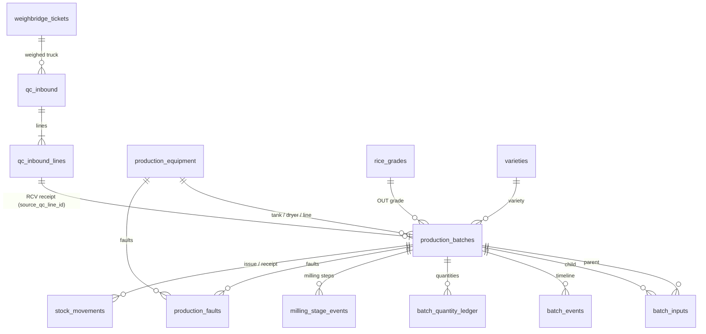

# Production Batch Traceability — Paddy to Rice

Module of the SRS Overseas ERP (Next.js 15 + Supabase). Tracks every batch from truck receipt to final rice grade, with permanent IDs, parent→child quantities, timestamps, users, and forward/backward tracing.

## 0. Current flow (after client feedback, 14 Nov 2026)

The client reviewed the module and asked for these changes; they are live:

1. **No pre-cleaning record.** Unloaded trucks go straight into a soaking tank (Production → Soaking tanks → *Load a tank from trucks*). The truck's receipt ID (`RCV-`) is created automatically at that moment. Older pre-cleaning batches stay valid and traceable.
2. **Tanks are not weighed.** Each variety has a standard paddy weight per tank (Admin → Masters → Varieties, in quintals). Loading a tank defaults to that weight. Recovery is worked out from it.
3. **Steaming lots.** A lot (`LOT-2026-00001`) is one or more finished soaking tanks, usually a pair, steamed continuously one tank after another. The operator picks the dryer when steaming starts; **any free dryer** can take any lot (e.g. Tank 5 into Dryer 1 when a tank is faulty). *Steaming done → load dryer* closes the lot and starts drying in one step.
4. **Three mill feed tanks** (MFT-1 to MFT-3).

Sections below describe the full design; where they mention pre-cleaning, fixed pairs or `STM-` IDs, this section takes precedence.

## 1. Audit of the existing ERP (what was reused)

| Existing piece | How the module uses it |
|---|---|
| `weighbridge_tickets`, `rst_cycles` | Source of RST, vehicle, gross/tare/net. RST is stored only as a reference (it resets); the receipt gets its own permanent `RCV-` ID. |
| `qc_inbound` / `qc_inbound_lines` (posted) | A truck receipt is created from a **posted** unloading-QC line (supplier, broker, variety, moisture, lot, accepted kg). One receipt per QC line — never twice. |
| `stock_movements` (append-only ledger) | Receipt issues the paddy lot out of yard stock (`production_issue`); a confirmed rice output is received into finished-goods stock (`production_receipt`, lot = OUT ID). Cancelling a receipt posts a `reversal`. |
| `audit_log` + `audit_trigger()` + `app.reason` | All production tables are audited; corrections and cancellations carry their reason. `production_audit_logs` is a view over it. |
| `has_role` / `require_role` / RLS pattern | Same role checks, now with 5 new production roles. |
| "Processing" placeholder module / nav key | Replaced by the Production module (`/processing` redirects to `/production`). |
| UI kit, Realtime live refresh | Same cards, badges and tables; production tables added to Realtime. |

Nothing existing was dropped or rewritten. One guard was added to existing data: an unloading QC whose paddy is already in production can no longer be reversed underneath it.

## 2. Database schema

Migrations (non-destructive, additive only):

- `supabase/migrations/20261114000008_production_roles.sql` — adds roles `production_manager`, `soaking_operator`, `steaming_operator`, `drying_operator`, `milling_operator`.
- `supabase/migrations/20261114000009_production_traceability.sql` — everything below.
- `supabase/migrations/20261114000010_receipt_time_fix.sql` — receipt start time is capped at the QC posting time (a ticket weighed "after" its QC posting no longer fails).
- `supabase/migrations/20261114000011_client_flow_changes.sql` — client feedback: trucks go straight into soaking tanks (no pre-cleaning record, receipt created automatically), steaming lots (`LOT-` IDs), 3 mill feed tanks.
- `supabase/migrations/20261114000012_rounding_leftovers.sql` — less than 1 kg left counts as fully used, so tanks and dryers free up.
- `supabase/migrations/20261114000013_flexible_dryers_std_weight.sql` — any finished tanks may form a lot and go into any free dryer (chosen at steaming start, `target_dryer_id`); standard paddy weight per tank for each variety (`varieties.std_tank_kg`).
- `supabase/seed.sql` — now also seeds the factory equipment for new databases.

### Design choice

All stages live in **one** table, `production_batches`, with a `stage` column, and every material movement is an **edge** in `batch_inputs (parent → child, qty)`. This makes backward/forward tracing a single recursive walk regardless of how trucks split across tanks or dryer batches split across feed tanks. The stage-specific entities requested are provided as views, so reports and integrations can query them by name.

### Tables

| Table | Purpose |
|---|---|
| `production_equipment` | Pre-cleaner, Tanks 1–6 (`pair_no` 1–3), common steamer, Dryers 1–3 (`pair_no` = pair served), mill feed tanks, milling line. Capacities and expected hours from the process diagram. |
| `rice_grades` | 1st Wand, 2nd Wand, Tibaar, Dubaar, Broken, Rejection, Resort with **reference** % only. |
| `batch_counters` | Per-prefix, per-year counter for readable IDs. |
| `production_batches` | Every batch of every stage: `batch_no`, `stage`, `status` (running / completed / consumed / cancelled), equipment, pair, variety, grade, `input_kg`, `output_kg`, `rejected_kg`, generated `loss_kg`, `output_qty_status` (estimated / entered / approved / confirmed), moisture, quality, `started_at`, `ended_at`, generated `duration_minutes`, operator, completed/approved/confirmed by & at, receipt `source_qc_line_id` + frozen `source_snapshot`, authorisation, cancellation, `request_id` (idempotency). |
| `batch_inputs` | Genealogy edges: `child_id`, `parent_id`, `qty_kg`. Unique per pair. |
| `batch_events` | Append-only timeline: stage, event type, time, user, quantity, related batch, note, data. |
| `batch_quantity_ledger` | Append-only quantity journal: input, output, rejected, consumed, released, correction, stock issue/receipt/reversal, with trust level. |
| `milling_stage_events` | Start/end of cleaning → dehusking → whitener → silky → sortex → grading per milling batch. |
| `production_faults` | Equipment/batch faults with severity, start/end and generated downtime. |

### Views (requested logical entities)

`truck_receipts`, `precleaning_batches`, `soaking_batches`, `steaming_batches`, `drying_batches`, `mill_feed_batches`, `milling_batches`, `production_outputs`, `tank_allocations`, `steaming_batch_inputs`, `drying_batch_inputs`, `production_batch_balances` (consumed / available per batch), `production_audit_logs`. All are `security_invoker`, so RLS applies.

### ER diagram



Material flow (each arrow is a `batch_inputs` edge with a quantity):

```
RCV (truck) ─┬─► SOAK Tank 1 ─┐
             └─► SOAK Tank 2 ─┴─► LOT (steaming) ─► DRY any free dryer ─┬─► MFD tank 1 ─┐
                                                                               └─► MFD tank 2 ─┴─► MIL ─┬─► OUT 1st Wand
                                                                                                         ├─► OUT 2nd Wand … (7 grades)
```

### IDs

`RCV-YYYY-00001`, `SOAK-`, `LOT-` (steaming lot; `STM-` before 14 Nov), `PC-` (pre-cleaning, no longer used), `DRY-`, `MFD-`, `MIL-`, `OUT-` generated only in the database by `next_batch_no(stage)`: `INSERT … ON CONFLICT DO UPDATE … RETURNING` on `batch_counters` takes a row lock, so concurrent requests serialise and get distinct numbers. A rolled-back transaction also rolls back its counter, so committed IDs have no gaps; cancelled batches keep their ID; IDs are never edited (direct updates are blocked). The year is the IST year.

## 3. Business rules (enforced in the database)

| Rule | Where |
|---|---|
| Soaking takes trucks (receipts) directly; each other stage only takes its previous stage | `start_production_batch` → `WRONG_SOURCE` |
| A tank / steamer / dryer that still holds material cannot be loaded | `EQUIPMENT_BUSY` (row lock on the equipment) |
| Only one steaming run at a time | check + partial unique index `production_one_running_steam` |
| A steaming lot takes one or more **completed** soaking tanks | `INCOMPLETE_BATCH` |
| A lot goes into the dryer chosen at steaming start; a dryer that holds paddy or is promised to a steaming lot cannot be chosen | `start_steaming_lot` → `DRYER_BUSY` |
| Incomplete batches cannot move forward; outputs need completed milling | `INCOMPLETE_BATCH` |
| No duplicate consumption; truck received once | `DUPLICATE_CONSUMPTION`, unique `source_qc_line_id`, unique `(child, parent)` |
| Allocation ≤ available unless a production manager authorises with a reason | `OVER_ALLOCATION` |
| Milling several feed lots together needs manager authorisation | `MULTI_INPUT` |
| Steaming and drying take the whole parent; other stages allow partial transfer | `start_production_batch` |
| Output never assumed equal to input: pre-cleaning, drying and milling require an entered output; soaking/steaming may be left blank and are then marked **estimated** | `complete_production_batch` |
| Output + rejection ≤ input (except soaking/steaming, which gain water) | `complete_production_batch` |
| Every start/stop records user and timestamp; future timestamps rejected | events + checks |
| No deletes; edits only through actions | guard triggers; append-only events and ledger |
| Corrections keep the original value (event `data.old/new`, ledger, audit with reason); cannot go below what was already passed on | `correct_batch_quantity` |
| Cancelled batches stay searchable; their material is released back to the parent; a cancelled receipt is reversed into stock | `cancel_production_batch` |
| Safe retry: every create action carries a `request_id`; a resubmitted form returns the original batch | `request_id unique` |

## 4. Roles and permissions

| Role | Can |
|---|---|
| Admin | Everything |
| Production manager | All stages, approvals, physical confirmation into stock, corrections, cancellations, authorisations, fault resolution |
| Soaking operator | Loading trucks into soaking tanks (creates the receipt) and soaking |
| Steaming operator | Steaming lots, and loading the lot into its dryer |
| Drying operator | Drying and mill-feed transfers |
| Milling operator | Milling, milling steps, recording outputs |
| Foreman (existing) | Pre-cleaning, soaking, steaming, drying, mill feed (boiler-side stages) |
| QC head (existing) | Create truck receipts, record moisture/quality |
| Management | Read-only: all screens, trace, reports |

Enforced by `require_stage_role()` / `require_role()` inside every function and by RLS (read-only policies; no direct write policies). The UI hides actions a role cannot perform, but the database is the authority.

## 5. API

All endpoints use the signed-in session (cookie); RLS limits what is returned. `:id` is a uuid **or** a readable batch number. Not signed in → `401` JSON.

| Endpoint | Returns |
|---|---|
| `GET /api/production/trace/:id` | `batch`, `origin` (truck snapshot(s)), `ancestors[]`, `descendants[]` (each edge with brief batch info and quantity), `timeline[]` |
| `GET /api/production/trace/:id/ancestors` | Backward trace to the truck(s) |
| `GET /api/production/trace/:id/descendants` | Forward trace to every resulting batch and grade |
| `GET /api/production/trace/:id/timeline` | Chronological events of the batch and its whole lineage (user, time, quantity, stage) |
| `GET /api/production/batches/:id` | Batch, balance (consumed/available), inputs, outputs, milling steps, faults, events, quantity ledger |
| `GET /api/production/reports/:report?from=&to=[&format=json]` | CSV (Excel-ready, UTF-8 BOM) or JSON. Reports: `daily`, `soaking`, `steaming`, `dryer`, `milling`, `grade`, `loss`, `operator`, `genealogy`, `truck` |

Database functions (Supabase RPC): `create_receipt_batch`, `start_production_batch`, `complete_production_batch`, `record_milling_step`, `record_production_output`, `approve_batch_quantity`, `confirm_production_output`, `set_batch_quality`, `correct_batch_quantity`, `cancel_production_batch`, `report_production_fault`, `resolve_production_fault`, `trace_ancestors`, `trace_descendants`, `trace_timeline`, `find_production_batches`, `production_receivable_lines`.

## 6. Screens

| # | Screen | Path |
|---|---|---|
| 1 | Production overview (plant floor in process order, attention list, today by grade, latest activity) | `/production` |
| 2 | Truck receipt & production entry | `/production/receipts` |
| 3 | Trucks (unloaded trucks waiting for a tank, trucks in production) | `/production/receipts` |
| 4 | Six-tank soaking board | `/production/soaking` |
| 5 | Steaming lots (pick tanks + dryer, *Steaming done → load dryer*) | `/production/steaming` |
| 6 | Three-dryer board | `/production/drying` |
| 7 | Mill feed transfers | `/production/mill-feed` |
| 8 | Milling with 6 timed steps | `/production/milling` |
| 9 | Final rice output (actual vs reference %, approve, quality, confirm to stock) | `/production/outputs` |
| 10 | Batch traceability search (truck card, genealogy by stage, backward/forward, timeline) | `/production/trace` |
| 11 | Production timeline (date, stage, user filters) | `/production/timeline` |
| 12 | Reports (10 reports, CSV/Excel) | `/production/reports` |
| — | Batch detail (all fields, came from / went to, history, ledger, actions) | `/production/batches/:batchNo` |
| — | Faults & downtime | `/production/faults` |

Quantities are entered in **quintals** on the floor and stored in kg. Every list has batch-ID search, status and date filters. Pages are responsive and update live via Supabase Realtime.

## 7. Test results

`npm run db:verify` runs all migrations on an in-memory Postgres and executes the scenarios. Result: **111 passed, 0 failed** (42 existing + 69 production, including the client-feedback flow: trucks straight into tanks, single-tank and cross-dryer lots, busy and promised dryers, standard tank weight, 3 feed tanks, sub-kilogram leftovers).

**Live database (14 Nov 2026, after migrations 11–13):** a self-rolling-back run of the new flow passed: standard weight shown to the soaking operator, truck loaded straight into Tanks 3 and 4 with one receipt, Tanks 3+4 → `LOT-2026-00001` into Dryer 3, promised dryer refused for another lot, *steaming done* loaded Dryer 3, dried lot moved to Mill Feed Tank 3, and the feed tank traced back to the truck.

Factory scenarios:

- **S1** Truck of 160 q → `RCV-YYYY-00001`, RST/vehicle/supplier frozen, paddy issued from yard stock.
- **S2** 79.5 q to Tank 1 and 79.5 q to Tank 2 from one pre-cleaning batch.
- **S3** Both tanks complete (one weighed → *entered*, one not → *estimated*); 12 h duration recorded.
- **S4** Tank 1 + 2 → one steaming batch, 160.5 q combined.
- **S5** Steaming pair 1 → Dryer 1 (13.5 % moisture, 13 h, 20.5 q drying loss).
- **S6** Dryer batch → two mill-feed transfers → one milling batch (authorised), 6 timed steps.
- **S7** Seven grade outputs with their own OUT IDs.
- **S8** From the 1st Wand OUT ID: truck, RST, vehicle, both tanks (1 and 2) with times, steaming, dryer, mill feeds, milling and pre-cleaning all retrieved; forward trace from the truck reaches all 7 outputs; timeline in order with users and quantities; search by RST and by vehicle number works.

Negative and integrity checks:

- **Wrong targets:** wrong dryer, wrong pair, a tank already loaded, and a second steaming run are all blocked.
- **Order and completeness:** steaming before both tanks finish, out-of-order milling steps, and outputs before milling completes are all blocked.
- **Quantities:**
  - Duplicate consumption, a duplicate truck receipt, over-allocation and partial transfers beyond what is left are all blocked.
  - An operator cannot self-authorise; management is read-only; commercial cannot see production.
- **Records:**
  - Direct edits and deletes are blocked, and the quantity ledger is append-only.
  - A cancelled output stays searchable and releases its quantity.
  - A correction keeps the old value plus an audit entry with its reason, and cannot go below what was already used.
  - A QC already in production cannot be reversed.
- **Retries and IDs:**
  - A safe retry (same `request_id`) returns the same batch for receipts and tank allocations.
  - 200 generated IDs are unique and correctly formatted.
- **Stock, quality and downtime:** a confirmed output enters finished stock under its OUT ID, and fault downtime is calculated.

**Live database (14 Nov 2026):** the same S1–S8 flow plus the key guards ran on the production Supabase project inside a block that rolls itself back: **16 passed, 0 failed**. The truck was traced to `RCV-2026-00001`, Tanks 1+2, and 52 timeline events. Afterwards there were 0 production rows, 0 test users, and the ID counters were back on their real values.

Concurrency of ID generation relies on PostgreSQL row locking in `INSERT … ON CONFLICT DO UPDATE`; the in-memory test runs single-connection, so true parallel generation should also be checked once on the live database (see §8).

## 8. Deployment

1. Apply migrations 08–13, in order and as separate runs, to the Supabase project. *(Done on the live project on 14 Nov 2026.)*
   - **Option A:** Supabase Dashboard → SQL Editor. Paste and run `20261114000008_production_roles.sql`, **then** `20261114000009_production_traceability.sql`. They must be separate runs.
   - **Option B:** `supabase db push`, if the project is linked.

   Both are additive: no existing table is altered except one new trigger on `qc_inbound`, and no data is reset. The second migration seeds equipment for existing plants.
2. Deploy the app: `vercel deploy --prod` (or push to the connected Git branch).
3. In Admin → Users & roles, give people the new production roles.
4. Check that the equipment matches the floor: names, capacities and the number of mill feed tanks. Edit `production_equipment` if not.
5. Smoke test: post an unloading QC → Production → Soaking tanks → *Load a tank from trucks*, then walk one lot through steaming, drying, mill feed and milling to an output and trace it.

## 9. Pending business decisions

1. ~~Mill feed tanks~~ — resolved: 3 tanks.
2. **Other equipment:** is there more than one milling line?
3. ~~Soaking weight~~ — resolved: tanks are not weighed; the client will supply a **standard weight per tank for each variety** (still to be entered in Admin → Masters).
4. **Paddy measure:** should milling recovery % be measured against dry paddy received, or against the dryer output? Reports currently use milling input, which is dryer output.
5. **Mixed loads:**
   - Can two trucks or varieties be mixed in one tank?
   - If yes, the rice output's variety becomes "mixed", and it must be stocked manually; it cannot be confirmed into stock under one variety.
6. **Operator assignment:** are operators assigned to specific tanks or dryers? Today any soaking operator can run any tank.
7. **Approval workflow:** which stages need production-manager approval before the next stage starts? Today approval is recorded but not required.
8. **Reference recovery percentages:** should they differ by variety? Today one set is used for hybrid paddy.
9. **Physical confirmation:** what is the tolerance between entered and physically counted output before an alert?
10. **Mid-stage ownership:** should paddy in mill feed tanks be stock locations in Inventory? Today they are tracked in production only.
11. **Rejected material:** should drying or milling rejects be tracked as by-product stock (husk, bran, chaff)?
12. **ID year boundary:** IDs restart at 00001 each calendar year (IST). Should this follow the financial year (April) instead?
13. **"Please remove this one"** (client video, 0:29, on the Soaking screen): which item should be removed? Not identifiable from the recording.
14. **Milling and outputs:** the client said they would explain these steps next; they are unchanged until then.
